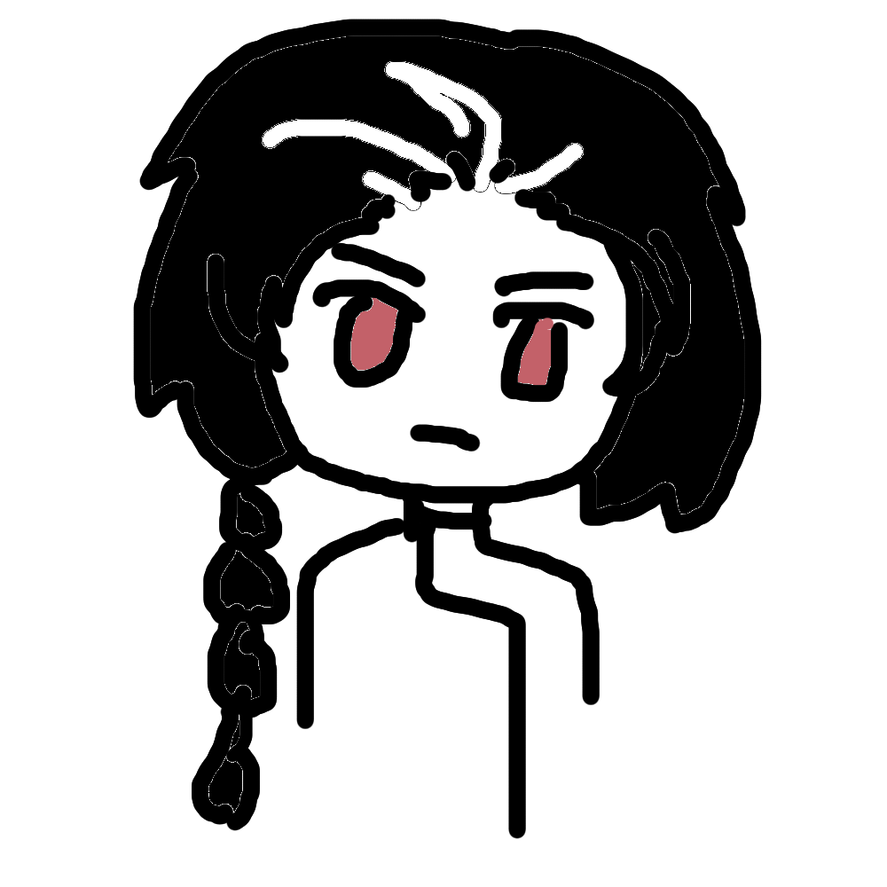

---
{
    "id": "ellery",
    "title": "엘러리",
    "quote": "뭔가 인용구",
    "quote_from": "— 심상 시커즈 4, 공식 홈페이지",
    "intro": [
        "심상 시커즈 4의 등장인물. 카타리의 부하로, 주인공의 여정을 지켜보면서 안내하는 역할을 맡는다."
    ]
}
---

## 작중 행적

(시리즈 전통 미스터리한 강화 공간)의 주민이자 [카타리](katari)의 부하. 주인공 또래의 남자아이로, 이런 저런 강화 기능을 맡는다.

게임이 시작되자 마자 등장한다. [주인공](ryo)에게 이름을 물어보는 역할이다. 문답이 끝나면 '정말... 그게 네 이름이라고 생각해?'라고 의미심장한 반응을 보였다가, 주인공의 여정을 지켜보겠다고 한 뒤 의자를 밀어서 바닥으로 패대기를 친다. 이후 주인공은 잠에서 깨어난다.

시간이 지나 심상세계에 진입한 뒤 파티를 (시리즈 전통 미스터리한 강화 공간)을 안내한다.

학교 생활에 관심이 많아 관련 서브퀘스트를 내주며, 틈이 있으면 주인공을 때린다. 주인공의 내적 독백을 보면 상당히 아프다고 한다. 어째서인지는 모르겠지만 다른 아이들은 때리지 않고 친절하게 군다.

### 여름방학

오키나와 여행을 같이 가자고 제안받지만, 자신은 세상의 틈의 있는 이 곳에 동화되어 나갈 수 없으니 불가능하다고 한다. 주인공이 잊지 않고 선물이라도 사간다. 이때의 기념품은 유리 공예품.

### 진실

스포일러가 있습니다. 열람하시겠습니까?

주인공의 비밀이 밝혀지고, 어떻게 탐색을 하다보면 마지막 방에서 갑자기 나타난다. 그리고 **심상: 원더러**를 소환하며 싸움을 다짜고짜 건다. 이때 바람에 머리카락이 날리며 얼굴이 드러나는데, 그 모습은...

**주인공과 똑같은 얼굴이었다.**

> "짜증나. 기분나빠... 네 존재 자체가 싫어! 내 인생을 뺏어놓고 여태까지 자각도 없었다고?! 웃기지 마!!"

전투가 시작되며 엘러리가 공격을 마구 퍼붓는다. 화를 내는 것과 동시에 털어놓는 진실은, **엘러리가 진짜 아카사카 료-플레이어가 설정한 이름의 주인이라는 것이었다.**

6~7살 정도의 미취학 아동이었던 시절, 엘러리는 부모님이 조금 바쁘지만 화목한 가정에서 살고 있었다. 그러던 어느날 장난으로 숨기 위해 옷장에 들어가 문을 닫았다가 심상 세계의 진입 조건인 '어둡고 밀폐된 공간'을 충족시키고 말았고, 우연히 심상세계에 진입하게 된다. 그 빈자리를 대체한 것이 그게 바로 [주인공](ryo)이다.

이후 주인공은 자신이 도플갱어였다는 사실을 잊고 '아카사카 료'로서 삶을 대신 살았다. 심상세계를 헤메던 진짜는 카타리에게 거두어졌고 지금의 엘러리가 되었다. 카타리가 한번은 다시 집에 돌려보내줬지만, 그때는 이미 주인공이 자신의 인생에 안착하고 잘 살고 있는 뒤였기 때문에 다시 돌아갈 엄두가 나지 않았다고.

이미 현실 세계의 삶보다 피안의 세계 주민으로서의 삶이 더 길어졌다. 옛날에 돌아갈 기회를 스스로 포기하기도 했다. 이성적으로 생각해보면 주인공에게 더이상 감정을 가지지 않는게 맞겠지만, 마음이 그렇지 않다면서 주인공을 마구 공격한다.

그러다가 피를 다 깎으면 주인공이 선물한 유리 공예품을 실수로 부숴버리고, 그 자리에서 멈칫하다가 무릎을 꿇고 파편을 줍는다. 보스전은 이렇게 끝.

이후 주인공에게만 말을 전한다. 그것은 **심상세계의 근원에 진입해 심장을 부수면 심상 세계 자체가 없어지지만, 심상의 존재인 주인공도 함께 죽게 될 것이라는 사실**이었다.

## 평가

**본작의 엄청난 인기 캐릭터.** 어쩌면 삶을 빼앗긴 최대의 피해자.

(뭔가 서술 더)

다만 부정적인 평가도 존재한다. 동기가 어찌되었든 류자키를 유혹해서 세뇌의 힘을 주었고, 심상 탐색대를 이용하려고 했으며, (결과적으로는) 주인공을 죽이려고 시도했다. '사실은 불쌍한 녀석이었어'로 미화되는 것 때문에 오히려 거부감을 가지는 사람도 있다.

## 보스전

(시리즈 전통 강화 공간)의 주민으로서는 이례적으로, 6번째 던전 (뭐시기 이름)의 보스로 등장한다. 자세한 사항은 위의 스포일러 항목 참고.

상당히 독특한 기믹을 가진 보스전이다. 전투가 시작되면 주인공의 MP를 바닥내 스킬을 봉인하는데, 대신 아이템 창에 이 전투에서만 쓸 수 있는 무한 회복 아이템이 추가된다. 사실상 회복해가며 끈질기게 버티라는 뜻.

엘러리의 HP가 10% 깎일 때마다 대사가 나오며, 스토리상 중요한 내용을 담고 있다. 한 번에 큰 피해를 주어 대사를 건너뛰는 것은 불가능하다.

전략이 중요한 전투라기보다는 이벤트전에 가깝다.

## 서브 퀘스트 

동아리에 들어가기

인연 랭크를 10까지 찍기

## 기타

- **인기투표 1위**.
- 인기에 힘 입어 애니메이션에서 작화가 엄청나게 잘 뽑혔다.
- 학교생활을 라노벨로 배운듯 하다. 소꿉친구에 대한 환상을 가지고 있다. 정작 작중에는 소꿉친구 사이가 일절 나오지 않지만...
- 주인공과 성우가 같다. 
- 

스포일러
주인공과 동일한 성우의 기운을 느낀 플레이어들은 곧바로 '아 얘가 진짜 료겠구나'하고 짐작해서 반전을 바로 알아맞추기도 한다.

