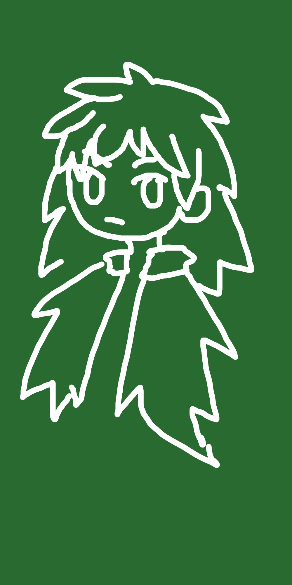

---
{
  "id": "harnire",
  "title": "하르니레",
  "quote": "고목의 수호신. 어린아이같은 성격을 가지고 있다.",
  "quote_from": "— 심상 시커즈 4 공식 홈페이지",
  "intro": [
    "세츠레이 고등학교 뒷편, 300년이 넘은 느릅나무의 수호신. 악신으로부터 학교를 지키고 싶다며 도움을 청한다."
  ]
}
---
## 성격

### 바보

복잡한 생각을 못하고 단순하다. 학교 이외의 세상을 접한적이 없기 때문으로 보인다. 그렇지만 애는 착하다.

## 작중 행적

<!-- component: party4 -->

### 주인공과의 접촉

심상세계에 처음 갔다온 주인공이 어리둥절하고 있을 때 날아오는게 첫 등장이다. 주인공을 학교 후원의 거대한 나무 앞으로 데려가서 이 나무가 신령적인 존재가 된 것이 바로 자신이라고 소개한다. 학교보다 더 오래된 존재로, 평상시에는 학교의 학생들을 수호하는 역할을 맡고 있다고. 하지만 최근 들어서 사악한 존재가 학교에 나타났는데 능력이 부족해서 막을 수 없고, 뭔진 모르겠지만 주인공이 뭔가 힘을 각성한 것 같으니 그것으로 자신을 도와달라고 한다.

이후 정보를 모으거나 쓸만한걸 물어다주는 역할을 한다. '학교 후원에 동전을 던지면 소원이 이루어진다'라는 소문을 내서 동전을 주워오는 것으로 활동비를 지원해주기도(...).

### 여름 방학

[토와](towa.html)가 주도한 오키나와 해변 여행에서 갑자기 나타나서 아는 체를 하는 아이가 바로 하르니레다. 없는 힘을 쥐어짜내 인간으로 현신했다고. 이때의 모습은 깃털같은 망토를 걸친 초등학생 저학년 정도의 어린 아이. 본인은 힘이 부족해서 작은 모습으로밖에 현신하지 못했다고 한다. 주인공이 '정신연령이 반영된 것인가'하고 생각하는 묘사가 있다.

어떻게 파티가 놀러다니는데 껴서 같이 다니는데, 비둘기한테 먹이를 주다가 쫓겨다니는 하찮은 모습을 보인다...

## 기타

- 하르니에가 아니라 하르니레다.
- 인기투표는 7위.
- 모티브는 홋카이도에 서식하는 긴점박이올배미. 그렇지만 진짜 새는 아니라고. 견과류는 좋아하지만 벌레나 지렁이는 질색하면서 사양한다. 평소엔 광합성으로 에너지를 얻는다고 한다.
- 전자기기에 약한 모습을 보인다. 대체로는 신기하게 처다보지만, 가스레인지 만큼은 '불을 뿜는 괴물'이라고 무서워한다.